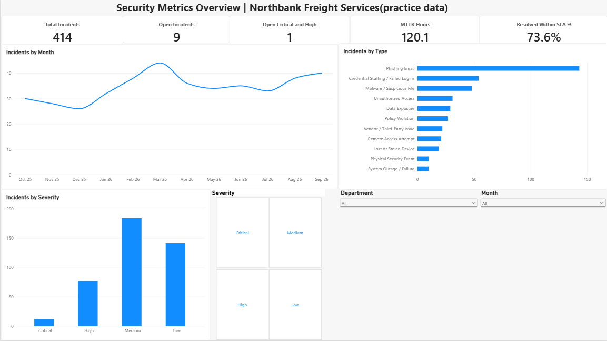
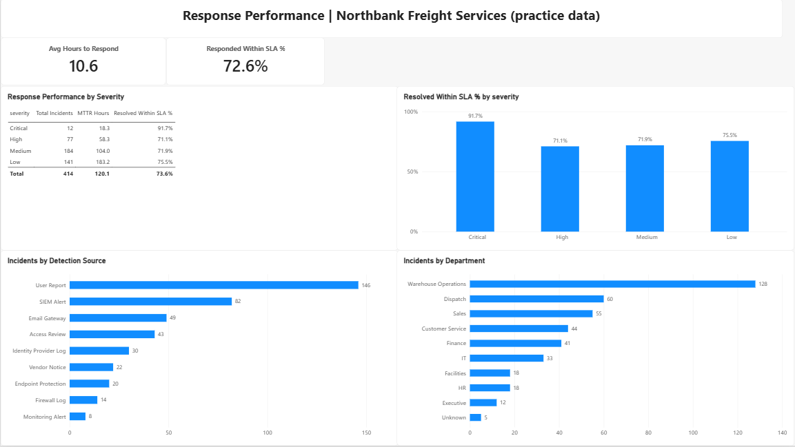
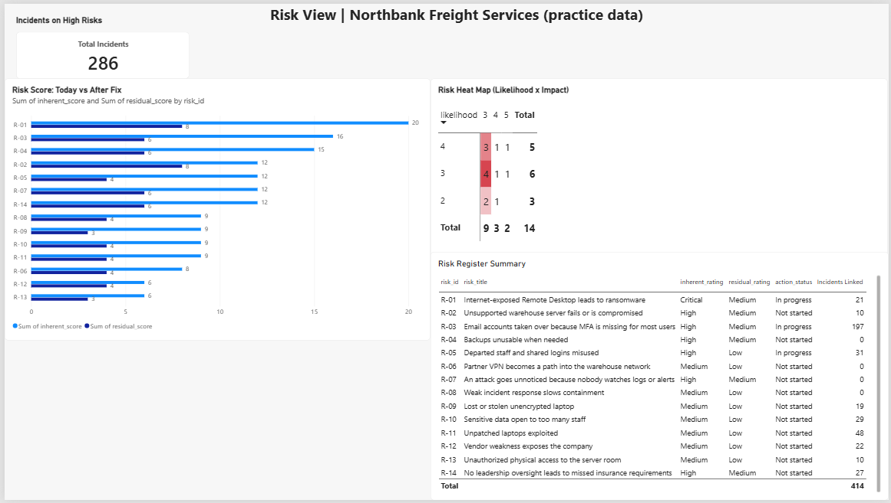

# Security Metrics Dashboard in Power BI

This is a Power BI dashboard I made for a company that does not exist, called Northbank Freight Services. I used practice data that I generated myself, so the numbers are not real. It is my third project. The first was a phishing email investigation and the second was a NIST CSF risk assessment. This one uses the risks from my second project and shows which incidents connect to them.

## About the data
Northbank Freight Services is a **made-up** company. The incident data is **practice data**, so none of the numbers describe a real company. The risk data comes from the risk register in my NIST CSF project. I cleaned the incident data before using it. The steps are in `docs/cleaning-log.md`.

## What the dashboard shows
The dashboard has 3 pages.

- **Overview:** how many incidents there are, how many are still open, incidents per month, and incidents by type, severity, department and how they were found. You can click the slicers to filter.
- **Response Performance:** how long it takes to respond to and fix incidents, and how many were fixed within the target time, by severity.
- **Risk View:** a heat map of risks (likelihood and impact), risk scores before and after the fix, and how many incidents are linked to each risk.

### Page 1: Overview


### Page 2: Response Performance


### Page 3: Risk View


## What I found
- Phishing email is the most common incident, with 143 out of 414.
- March 2026 was the busiest month, with 44 incidents.
- About 73.6% of incidents were fixed within their target time. Critical incidents did best (91.7%) and High did worst (71.1%).
- Risk R-03 (email accounts taken over because MFA is missing) has the most incidents linked to it, 197. Altogether, 286 incidents are linked to High or Critical risks.
- 9 incidents are still open, and 1 of them is Critical or High.

## What is in this repository
```
data/             security_incidents.csv (cleaned), sla_targets.csv, risk_register.csv
data/raw/         the original incident file before cleaning
docs/             data-dictionary.md, kpi-definitions.md and cleaning-log.md
dashboard/        the Power BI file (.pbix)
screenshots/      pictures of each dashboard page
```

## How to open it
Download the `.pbix` file from the `dashboard` folder and open it in Power BI Desktop. It is free to download from Microsoft. If the data does not load, go to Transform data, then Data source settings, and point the files to the CSV files in the `data` folder.

## How I built it
1. I loaded the CSV files into Power BI and cleaned the data in Power Query.
2. I connected the tables to each other (incidents, SLA targets and risk register) and made a calendar table for the dates.
3. I made new columns for hours to respond, hours to resolve, and whether each incident met its target time.
4. I wrote DAX measures for total incidents, open incidents, MTTR and the SLA percentages.
5. I built the three pages with cards, charts, a matrix and a table, and added slicers.
6. I checked the dashboard numbers against the totals in the CSV files.

## Words I learned
- **Incident:** a security event that needs to be looked at, like a phishing email or a lost laptop.
- **SLA (service level agreement):** the target time to respond to or fix an incident.
- **MTTR (mean time to resolve):** the average time it takes to fix an incident.
- **KPI (key performance indicator):** a number that shows how well something is going.
- **DAX:** the formula language in Power BI.
- **Inherent and residual risk:** the risk before a fix, and the risk left after the fix.

## Tools I used
Power BI Desktop, Power Query, DAX, CSV files, Visual Studio Code and GitHub.

## Limits of this project
- The company and the incident data are made up, so the results only show how I work, not how a real company is doing.
- I chose the SLA target times myself, and I chose which incident types link to which risks.
- It has only 12 months and about 400 incidents, which is small compared with a real company.

## Author
Waseem Akram Shaik | MS in Management Information Systems, University of Memphis
